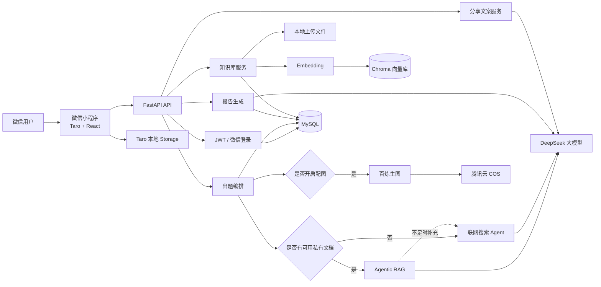
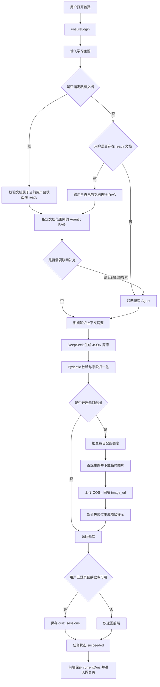
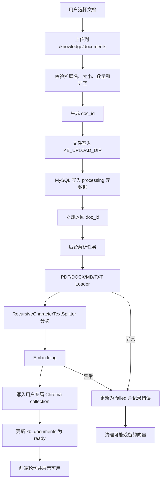
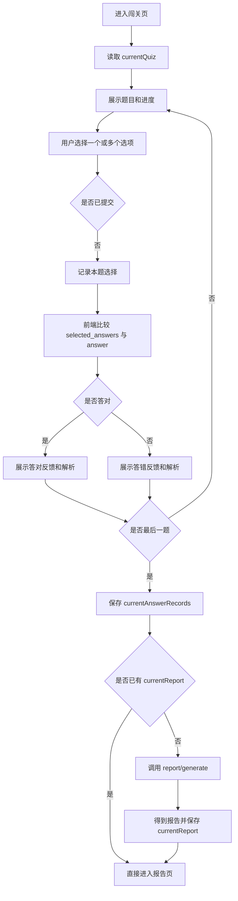
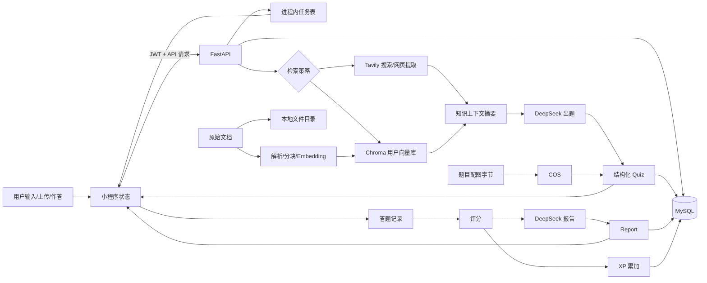
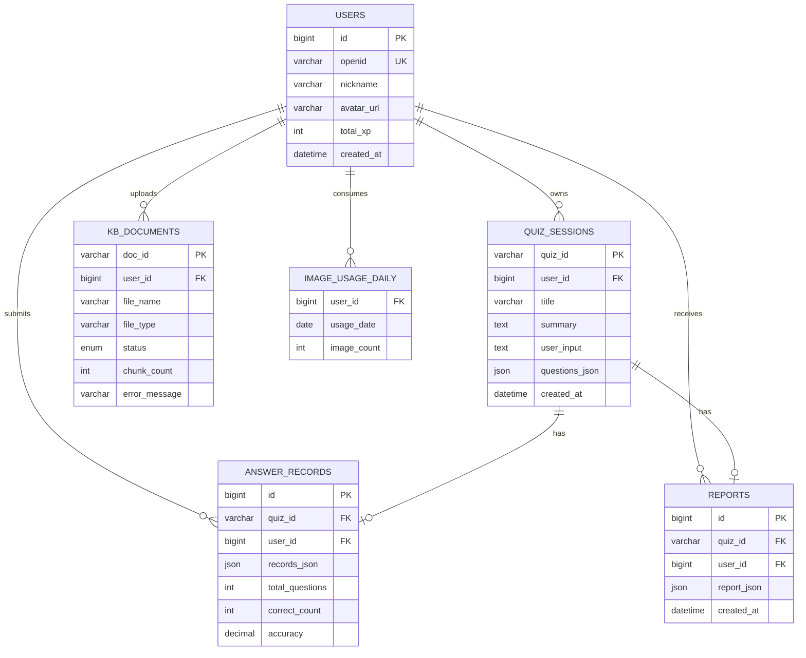
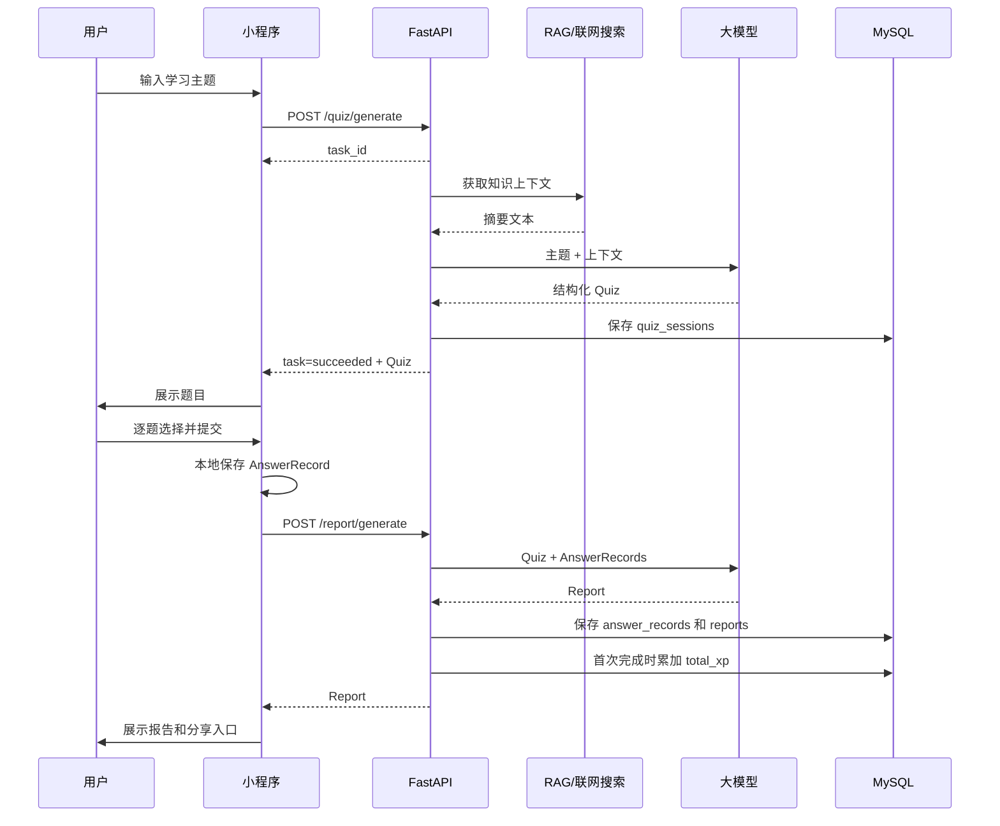

# cmint AI 闯关学习小程序：业务流程与数据流程说明

> 本文档基于当前仓库中的前端、后端、数据库脚本和现有功能实现整理。
> 文档重点说明“用户如何使用系统”和“数据如何在各模块之间流转”，不把需求文档中尚未实现的功能当成当前能力。

## 1. 项目定位与总体架构

cmint AI 是一个微信小程序形态的闯关学习工具。用户输入想学习的主题，系统通过私有知识库检索或联网搜索补充上下文，再由大模型生成结构化题库；用户逐题作答后，系统生成复盘报告并保存为历史记录，还可以生成带小程序码的分享海报。

当前系统由以下部分组成：

| 层次 | 主要模块 | 主要职责 |
| --- | --- | --- |
| 客户端 | Taro + React 微信小程序 | 登录、主题输入、知识库上传、轮询出题、答题、报告展示、海报绘制 |
| API 层 | FastAPI | 登录、用户资料、题库任务、报告、历史、知识库、海报文案接口 |
| 业务层 | quiz task、RAG、搜索、知识库、配图、评分 | 编排出题、异步任务、检索、文档处理、评分和降级 |
| AI 层 | DeepSeek 兼容接口、Tavily、百炼生图/Embedding | 出题、报告、海报文案、联网搜索、向量化、题目配图 |
| 持久化层 | MySQL、Chroma、本地文件、腾讯云 COS | 用户和闯关数据、向量、上传文件、头像、题目图片 |

### 1.1 总体架构图

## 2. 用户端页面与业务入口

| 页面 | 主要业务 | 关键数据 |
| --- | --- | --- |
| 首页 `/pages/index/index` | 登录、输入学习主题、选择是否配图、开始生成、查看最近完成记录 | `currentUser`、历史摘要、输入主题、配图开关 |
| 闯关页 `/pages/quiz/index` | 展示题目、选择答案、提交答案、即时反馈、进入下一题、生成报告 | `currentQuiz`、`currentAnswerRecords`、`currentReport` |
| 报告页 `/pages/report/index` | 展示正确率、掌握点、薄弱点、建议和分享金句 | `currentQuiz`、`currentAnswerRecords`、`currentReport` |
| 知识库页 `/pages/knowledge/index` | 上传、查看、重命名、删除私有文档，等待文档变为 ready | 文档列表、文档处理状态 |
| 我的 `/pages/me/index` | 查看用户资料和统计、修改头像/昵称、分页搜索历史、从历史生成海报 | 用户资料、历史分页、报告详情 |

前端将一次闯关的临时状态放入 Taro Storage，便于在页面之间传递和历史回看；最终权威数据仍保存在后端数据库中。

## 3. 核心业务流程

### 3.1 登录与用户初始化

1. 小程序进入首页或“我的”页面时调用 `ensureLogin`。
2. 如果本地已经有 `authToken` 和 `currentUser`，优先复用本地登录态。
3. 没有登录态时调用微信 `Taro.login()` 获取临时 `code`。
4. 后端使用 `code` 向微信换取 `openid`。
5. 按 `openid` 查询 `users`，不存在则创建用户。
6. 后端签发 JWT，返回 token 和用户基本资料。
7. 前端保存 token；后续请求在 `Authorization` 请求头中携带 JWT。
8. 页面继续请求用户档案和历史摘要。

登录态只表达“用户是谁”，当前没有角色或权限等级系统。知识库、用户资料和历史记录要求登录；普通主题出题可以按当前接口依赖允许匿名生成，但匿名结果不会落入用户历史。

### 3.2 主题出题主流程

首页要求用户输入学习内容，当前前端默认生成 5 道混合难度题目。用户可以额外开启“生成图片”。

#### 3.2.1 为什么出题采用任务轮询

出题可能同时包含联网搜索、大模型调用和逐题生图，耗时可能超过微信请求的常规等待时间。因此：

1. `POST /api/v1/quiz/generate` 只创建进程内任务并立即返回 `task_id`。
2. 后端后台执行检索、生成、配图和持久化。
3. 前端每 3 秒调用 `GET /api/v1/quiz/generate/{task_id}`。
4. 前端收到 `succeeded` 后进入答题页，收到 `failed` 则展示错误。
5. 任务状态保存在单进程内存中，默认约 30 分钟过期；服务重启后任务状态丢失。

#### 3.2.2 题库生成与校验

大模型被要求返回结构化 JSON。后端使用模型层进行校验和容错：

- 支持单选题、多选题、判断题；
- 归一化中英文题型、难度和字段别名；
- 缺少题目 ID 时生成 `q1`、`q2` 等 ID；
- 判断题缺少选项时补齐“正确/错误”；
- 答案必须引用实际选项；
- 题目包含题干、选项、答案、解析、知识点、难度和可选图片地址。

### 3.3 私有知识库流程

知识库是当前已实现的登录用户能力，用于让题目基于用户上传的 PDF、DOCX、Markdown 或 TXT 文档生成。

知识库有三层隔离：

1. MySQL 文档元数据带 `user_id`。
2. Chroma 按用户使用 `kb_user_{user_id}` collection。
3. 向量 metadata 同时保存 `user_id` 和 `doc_id`，检索与删除都带过滤条件。

用户删除文档时，系统按“向量 → 本地文件 → MySQL 元数据”的方向清理；重命名只修改展示名，不重新解析，不影响已有闯关记录。

### 3.4 答题与即时反馈流程

答题阶段主要在前端完成：

- 单选题和判断题只能选择一个选项；
- 多选题允许切换多个选项；
- 已提交后不能修改当前题答案；
- 判断采用“答案集合完全一致”的规则；
- 每道题保存 `question_id`、`selected_answers` 和 `duration_ms`；
- 每道题无论答对答错都会立即展示题目解析。

### 3.5 复盘报告与 XP

完成最后一题后，前端将题库和答题记录提交到 `/api/v1/report/generate`。后端：

1. 根据题库和答题记录计算总题数、已答数、正确数和正确率。
2. 将题目、答案记录和统计信息交给报告大模型。
3. 校验报告结构。
4. 返回评价、掌握点、薄弱点、三句总结、建议和分享金句。
5. 登录用户将答题记录写入 `answer_records`，报告写入 `reports`。
6. 首次保存该局报告时，按正确题数计算 XP 并累加到 `users.total_xp`；重复打开或重复提交同一局不会重复累加。

### 3.6 历史记录与回看

首页和“我的”页面都可以请求历史列表。历史列表来自 `quiz_sessions`，左连接 `answer_records` 计算：

- 关卡标题；
- 是否完成；
- 题目数量；
- 正确率；
- 创建时间。

用户点击历史记录后，前端请求详情接口，恢复题库、答题记录和报告到本地 Storage，再进入闯关页。闯关页识别到已有答题记录后进入“回看模式”，展示当时的选择、正确答案和解析，不重复生成报告。

### 3.7 分享海报流程

分享有两层：

1. 微信小程序页面分享：使用报告金句或已缓存海报标题作为分享标题，路径回到首页。
2. 图片海报：前端打开 `SharePoster`，先尝试调用后端生成短标题和副标题；接口失败时降级为报告金句和成绩文案。随后前端加载小程序码和报告摘要，用 Canvas 绘制海报，导出临时 PNG，用户可以保存或分享。

海报图片本身由前端 Canvas 生成，后端只负责可选的海报文案，不保存海报文件。

## 4. 数据流程

### 4.1 端到端数据流程图

### 4.2 主要数据对象

| 数据对象 | 产生位置 | 主要字段 | 去向 |
| --- | --- | --- | --- |
| `User` | 微信登录 | `id`、`openid`、昵称、头像、`total_xp` | 用户资料、鉴权、历史归属 |
| `QuizTask` | 创建出题任务 | `task_id`、状态、题库、错误、降级提示 | 前端轮询；仅进程内 |
| `Quiz` | 大模型出题 | `quiz_id`、标题、用户输入、题目列表、`search_used` | 前端答题、`quiz_sessions` |
| `Question` | 题库生成/配图 | 题型、题干、选项、答案、解析、知识点、图片 URL | 答题、报告、历史回看 |
| `AnswerRecord` | 前端提交答案 | 题目 ID、选择结果、耗时 | 评分、`answer_records` |
| `Report` | 报告大模型 | 正确率、评价、掌握点、薄弱点、建议、金句 | 报告页、海报、`reports` |
| `KnowledgeDocument` | 文档上传 | `doc_id`、文件信息、状态、分块数、错误 | 知识库管理、RAG |
| 向量 chunk | 文档解析 | 文本块、`user_id`、`doc_id` metadata | Chroma 相似度检索 |
| `PosterCopy` | 海报文案接口 | `headline`、`subline` | 前端 Canvas，不入库 |

### 4.3 关系型数据模型

### 4.4 一次完整闯关的数据生命周期

## 5. 接口与状态边界

### 5.1 核心接口

| 接口 | 作用 | 数据边界 |
| --- | --- | --- |
| `POST /api/v1/user/login` | 微信 code 换 JWT | 写入/读取 `users` |
| `GET /api/v1/user/profile` | 获取用户统计 | `users` + 聚合历史 |
| `PUT /api/v1/user/profile` | 更新昵称/头像 URL | 更新 `users` |
| `POST /api/v1/user/avatar` | 上传头像 | 本地 `uploads` + `users.avatar_url` |
| `POST /api/v1/quiz/generate` | 创建异步出题任务 | 生成 `task_id` |
| `GET /api/v1/quiz/generate/{task_id}` | 查询出题任务 | 读取进程内任务状态 |
| `POST /api/v1/report/generate` | 生成复盘报告 | 写入答题记录、报告和 XP |
| `GET /api/v1/user/quizzes` | 分页/关键字查询历史 | 读取 `quiz_sessions` |
| `GET /api/v1/user/quizzes/{quiz_id}` | 获取历史详情 | 读取题库、答案、报告 |
| `POST /api/v1/knowledge/documents` | 上传私有文档 | 文件 + `kb_documents` + 后台向量化 |
| `GET /api/v1/knowledge/documents/{doc_id}` | 查询文档处理状态 | 读取 `kb_documents` |
| `PATCH/DELETE /api/v1/knowledge/documents/{doc_id}` | 改名/删除文档 | 更新或清理文档数据 |
| `POST /api/v1/share/poster-copy` | 生成海报短文案 | 不写业务数据库 |

### 5.2 关键状态

| 状态 | 所在对象 | 含义 |
| --- | --- | --- |
| `pending` | 出题任务 | 已创建，尚未开始执行 |
| `running` | 出题任务 | 正在检索、出题或配图 |
| `succeeded` | 出题任务 | 已得到可用题库 |
| `failed` | 出题任务/文档 | 处理失败，前端展示错误 |
| `processing` | 知识文档 | 已上传，正在解析和向量化 |
| `ready` | 知识文档 | 可以参与 RAG |
| `completed` | 历史列表派生状态 | 已存在答题记录和正确率 |

## 6. 异常、降级与一致性规则

1. **联网搜索失败**：返回空上下文，继续基于用户输入生成题目。
2. **RAG 失败或超时**：返回空上下文，不阻断普通出题。
3. **单题配图失败、额度用尽或服务未配置**：题库继续返回无图版本，并向前端返回提示。
4. **海报文案接口失败**：使用报告金句和成绩生成备用文案。
5. **报告已生成**：前端优先复用本地报告；后端保存报告时按 `quiz_id` 幂等更新，首次才增加 XP。
6. **登录过期**：前端清除 token 和缓存用户，提示重新登录。
7. **文档解析失败**：文档标记为 `failed`，保存错误信息，并尽力清理残留向量。
8. **历史数据隔离**：所有用户资料、历史、文档和向量查询都以 `user_id` 为边界。

## 7. 当前实现与后续规划的边界

### 当前已经形成闭环的能力

- 微信登录和 JWT 鉴权；
- 文本主题出题；
- 联网搜索增强出题；
- 用户私有文档上传、解析、Embedding 和 RAG；
- 单选、多选、判断题；
- 即时答案反馈和知识解析；
- 报告生成、历史保存、分页搜索和回看；
- XP 记录与首次完成幂等累加；
- 可选题目配图和每日配额；
- Canvas 分享海报和海报文案降级。

### 需求中仍属于规划或未形成完整产品闭环的能力

- 艾宾浩斯遗忘曲线和自动复习关卡；
- 双人 PK、排行榜和社交对战；
- 语音、数字人等多模态交互；
- VIP、按量付费和 B2B 套餐；
- 分布式任务队列和持久化任务状态；
- 更完整的学习知识树和长期能力分析。

## 8. 一句话总结

这个项目的核心业务闭环是：

> **用户登录并输入主题 → 系统优先检索用户私有知识、否则联网补充 → 大模型生成并校验题库 → 用户本地逐题作答 → 提交答案生成复盘报告 → 保存题库/答案/报告/XP → 历史回看和 Canvas 海报分享。**

