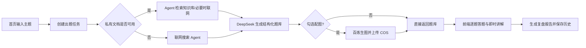

# cmint AI 项目功能实现说明

本文档按当前仓库中的实际代码说明实现，不把早期需求文档中的规划项当成已上线能力。

## 1. 项目现状与整体链路

项目是一个 Taro + React 前端、FastAPI 后端的微信小程序学习工具。核心闭环是：



后端启动入口是 `backend/app/main.py` 的 `app = create_app(use_database=True)`。题库生成使用进程内任务表，POST 接口立即返回 `task_id`，前端每 3 秒轮询任务状态；任务数据默认最多保留 30 分钟，服务重启后会丢失。这是当前 MVP 单进程部署的取舍。

## 2. MVP 核心闭环

### 2.1 首页输入与出题

前端首页 `frontend/src/pages/index/index.tsx` 保存用户输入、生成图片开关，并调用 `generateQuiz`。请求默认固定为 5 道题、`mixed` 难度；用户输入限制为 4000 字符。

后端接口：

| 接口 | 作用 |
| --- | --- |
| `POST /api/v1/quiz/generate` | 创建出题任务，返回 `task_id` |
| `GET /api/v1/quiz/generate/{task_id}` | 查询任务状态、题库、错误和降级提示 |
| `POST /api/v1/report/generate` | 根据题库与答题记录生成复盘报告 |
| `GET /api/v1/health` | 健康检查 |

`main.py` 中的 `build_quiz` 负责实际编排：选择搜索上下文、调用 `DeepSeekQuizGenerator`、设置 `search_used`、可选地附加图片，最后调用 `save_quiz` 保存历史。

### 2.2 题目生成

`backend/app/llm.py` 使用 `ChatPromptTemplate` 定义出题 Prompt，并通过 `ChatOpenAI` 的 OpenAI 兼容接口连接 DeepSeek。模型要求只返回 JSON，随后用 `Quiz.model_validate(...)` 做 Pydantic 校验。

题目模型支持：

- `single` 单选、`multiple` 多选、`judge` 判断；
- 选项、答案、解析、知识点、难度和可选 `image_url`；
- 模型漏传题型、选项或使用中文字段时，`backend/app/models.py` 提供归一化和补全；
- 答案必须引用实际选项，否则整份题库校验失败；
- 缺少题目 ID 时自动生成 `q1`、`q2` 等 ID。

### 2.3 答题与即时反馈

`frontend/src/pages/quiz/index.tsx` 在本地维护当前题目、已选答案和答题记录。点击提交后立即比较选项集合与题目答案：

- 答对或答错都展示 `question.explanation`；
- 多选题要求选择集合完全一致；
- 每题记录 `question_id`、`selected_answers` 和 `duration_ms`；
- 答完最后一题后调用报告接口。

当前前端的 XP 主要是展示层计算：报告页按答对题数乘以 2 展示本局 XP；用户表也有 `total_xp` 字段，但当前出题/答题代码没有看到将本局 XP 累加回用户表的业务更新。因此应把 XP 描述为“已有 UI 和字段，累计逻辑尚未形成完整闭环”。

### 2.4 复盘报告与历史

`DeepSeekReportGenerator` 先调用 `calculate_score` 得到总题数、已答数、正确数和正确率，再把题库、答题记录和统计交给报告 Prompt。返回值经过 `Report.model_validate`，报告包括评价、掌握点、薄弱点、三句总结、建议和分享金句。

报告生成后，登录用户通过 `save_report` 保存到 MySQL 的 `answer_records` 和 `reports` 表。前端把当前题库、答题记录和报告放入 Taro storage，历史页再通过接口恢复完整记录。

## 3. 用户系统

### 3.1 登录

前端 `ensureLogin` 调用微信 `Taro.login()` 获取临时 `code`，请求 `POST /api/v1/user/login`。后端流程是：

1. `HttpWeChatClient.exchange_code` 用微信 code 换取 `openid`；
2. 按 `openid` 查询 `users`，没有则创建用户；
3. `create_access_token` 签发 HS256 JWT；
4. 前端保存 `authToken` 和 `currentUser`，后续请求自动带 `Authorization: Bearer ...`。

JWT payload 包含 `user_id`、`openid`、`exp`。`optional_user_dependency` 允许接口匿名访问，真正需要用户的地方再调用 `require_user_id` 返回 401。知识库、用户资料和历史记录都必须登录。

### 3.2 用户资料和历史

| 接口 | 功能 |
| --- | --- |
| `GET /api/v1/user/profile` | 查询昵称、头像、XP 等资料 |
| `PUT /api/v1/user/profile` | 修改昵称或头像 URL |
| `POST /api/v1/user/avatar` | 上传头像，限制 JPG/PNG/WEBP/GIF、5 MB |
| `GET /api/v1/user/quizzes` | 分页查询闯关记录，可按 keyword 搜索 |
| `GET /api/v1/user/quizzes/{quiz_id}` | 查询题库、答题记录和报告详情 |

数据存储使用 `aiomysql` 连接池。`users`、`quiz_sessions`、`answer_records`、`reports` 通过外键关联，按用户 ID 查询，删除用户时级联清理。

当前认证边界的关键点是：JWT 只携带用户身份，不做角色系统；头像存到后端本地 `uploads` 目录并通过 StaticFiles 暴露；生产环境应替换为更可靠的对象存储和更严格的 CORS/密钥配置。

## 4. 联网搜题

### 4.1 搜索链路

没有可用私有文档时，`main.build_quiz` 调用 `search_service.fetch_knowledge_context`。该服务：

1. 检查 `ENABLE_WEB_SEARCH` 和 `TAVILY_API_KEY`；
2. 创建 `TavilySearch` basic/deep 两个搜索工具，以及 `TavilyExtract` URL 提取工具；
3. 用 DeepSeek + `create_agent` 让 Agent 根据主题选择工具；
4. 最多允许约 2 次工具调用，超时 15 秒；
5. 提取 Agent 最后的文本并截断到 3000 字符；
6. 搜索失败、超时或未配置 key 时返回空上下文，降级为仅基于用户输入出题。

`backend/app/prompts/search_prompt.py` 规定了简单主题用 basic、复杂/新主题用 deep、输入 URL 时用 extract，并要求最后只输出供出题模型使用的事实摘要。

### 4.2 搜索结果如何影响题目

搜索结果不会直接作为题库返回，而是作为 `search_context` 注入 `QUIZ_PROMPT` 的“参考资料”段落。Prompt 明确要求优先依据参考资料中的事实，`Quiz.search_used` 用于标识本次是否得到搜索或知识库上下文。

## 5. 用户上传文档并基于文档生题

### 5.1 上传和异步处理

接口位于 `backend/app/routers/knowledge.py`：

| 接口 | 功能 |
| --- | --- |
| `POST /api/v1/knowledge/documents` | 上传 PDF/DOCX/MD/TXT，立即返回 `doc_id` |
| `GET /api/v1/knowledge/documents` | 查询当前用户文档列表 |
| `GET /api/v1/knowledge/documents/{doc_id}` | 查询 processing/ready/failed 状态 |
| `PATCH /api/v1/knowledge/documents/{doc_id}` | 只修改展示名 |
| `DELETE /api/v1/knowledge/documents/{doc_id}` | 删除文档和向量 |

`knowledge_service.handle_upload` 的实际步骤是：校验扩展名、大小和用户文档数 → 生成 `doc_id` → 文件落到 `KB_UPLOAD_DIR` → 在 `kb_documents` 写入 processing 记录 → 创建进程内后台任务。

后台任务 `_process_document` 执行：

```text
文档 Loader -> RecursiveCharacterTextSplitter -> Embedding -> Chroma -> status=ready
```

支持的 Loader 是 `PyPDFLoader`、`Docx2txtLoader` 和 UTF-8 `TextLoader`。默认分块大小和重叠长度由 `KB_CHUNK_SIZE`、`KB_CHUNK_OVERLAP` 配置。

### 5.2 向量库和隔离

`vector_store_service` 为每个用户建立 `kb_user_{user_id}` Chroma collection，写入 chunk 时补充 `user_id` 和 `doc_id` metadata。检索始终带用户过滤；指定文档时再叠加 `doc_id` 过滤，避免跨用户或跨文档串数据。

Embedding 使用 `OpenAIEmbeddings` 连接百炼兼容接口，向量持久化目录由 `CHROMA_PERSIST_DIR` 配置。

### 5.3 基于文档出题

生成请求带 `doc_id` 时，接口先检查文档归属和 `ready` 状态。若用户没有指定文档但拥有 ready 文档，也会自动启用跨文档检索。

`rag_service` 创建 Agent，并固定一个带闭包参数的 `search_knowledge_base` 工具：`user_id` 和 `doc_id` 在服务端绑定，模型不能改变检索边界。若启用联网搜索且配置 Tavily，Agent 可以在私有文档不足时调用联网工具补充；私有资料覆盖核心事实时优先使用私有资料。

RAG 最终也只产出一段不超过 3000 字符的参考摘要，再复用同一个 `DeepSeekQuizGenerator`。检索失败或超时会返回空上下文，题目仍可生成，但不再声称基于文档。

删除文档时按“向量 → 本地文件 → MySQL 元数据”清理；失败会记录日志，文档权限检查仍按用户 ID 执行。

## 6. AI 配图

配图是 `GenerateQuizRequest.with_images` 控制的可选增强，默认关闭。未勾选时，出题主链路不会进入配图模块。

### 6.1 生成和保存

`quiz_image_service.attach_images` 对题目执行：

1. 检查 COS 和百炼配置；
2. 查询用户当天额度，受每日额度和单次题目图片数上限约束；
3. 用 `image_generation_service.build_image_prompt` 根据知识点和题干生成无文字插画 Prompt；
4. 调用百炼原生同步接口 `/services/aigc/multimodal-generation/generation`；
5. 从响应取得约 24 小时有效的临时 URL，立即下载图片字节；
6. 用 `cos_storage_service` 上传腾讯云 COS，回填永久 `question.image_url`；
7. 只对成功上传的图片累加 `image_usage_daily`。

生图任务使用信号量控制并发、最小间隔错峰，并对可重试错误做指数退避。单题失败、额度不足或服务未配置都只产生 `notice`，不让整个题库失败；题库保存时已经包含成功生成的图片 URL。

前端答题页只在 `question.image_url` 有值时展示图片，并支持预览。配图降级提示由任务状态返回，首页保存到 storage，答题页首次进入时 toast 展示。

## 7. 分享功能的现状

复盘页和“我的”页可以打开 `SharePoster`，前端用 Canvas 生成分享海报；后端 `POST /api/v1/share/poster-copy` 可选调用 DeepSeek 生成短标题和副标题，失败时回退到报告金句。海报图片本身由前端绘制，不是后端生成。

## 8. 测试覆盖

后端已有 API、用户系统、文档 Loader、知识库服务、RAG、联网搜索、向量库、配图和历史记录测试，例如：

- `backend/tests/test_user_system.py`
- `backend/tests/test_knowledge_api.py`
- `backend/tests/test_document_loader_service.py`
- `backend/tests/test_rag_service.py`
- `backend/tests/test_search_service.py`
- `backend/tests/test_quiz_generate_with_images.py`

前端没有 Jest/Vitest，主要通过 TypeScript 检查、微信构建和海报布局校验验证。
