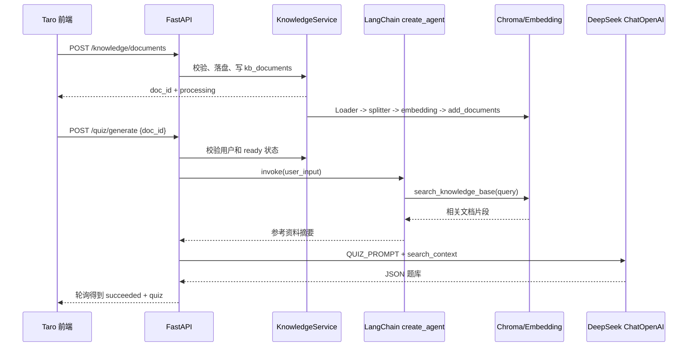

# cmint AI 项目框架使用说明

本文档只说明框架在当前代码中的实际落点，重点回答 FastAPI、LangChain、LangGraph 分别负责什么，以及代码如何串起来。

## 1. 框架分工

| 框架 | 当前项目中的职责 | 主要位置 |
| --- | --- | --- |
| FastAPI | HTTP API、参数校验、依赖注入、中间件、文件上传、生命周期管理、静态文件 | `backend/app/main.py`、`backend/app/routers/` |
| LangChain | Prompt、Chat 模型适配、Agent 工具、文档 Loader、文本切块、Embedding、Chroma 接入、Tavily 工具 | `backend/app/llm.py`、`backend/app/services/` |
| LangGraph | 作为 `langchain.agents.create_agent` 的底层 Agent 执行图 | 通过 `search_service.py`、`rag_service.py` 间接使用 |

`backend/requirements.txt` 同时声明了 `langgraph>=1.0,<2.0`，但项目没有直接导入 `StateGraph`、`START`、`END` 或自行定义图节点。阅读代码时不要把当前 Agent 误认为手写 LangGraph 工作流。

## 2. FastAPI 的使用方式

### 2.1 应用创建和生命周期

`create_app` 采用工厂函数，允许测试注入生成器、数据库、微信客户端和分享文案生成器：

```python
def create_app(
    quiz_generator=None,
    report_generator=None,
    database=None,
    wechat_client=None,
    ...,
) -> FastAPI:
    app = FastAPI(title=settings.product_name, version="0.1.0", lifespan=lifespan)
```

lifespan 启动时按需连接 MySQL，关闭时取消出题任务、等待知识库后台任务，并关闭连接池。这让生产应用和测试应用可以使用不同的基础设施。

### 2.2 路由注册

主业务路由直接写在 `main.py`，知识库和分享接口拆到 APIRouter：

```python
app.include_router(knowledge_router.router, prefix="/api/v1")
app.include_router(share_router.router, prefix="/api/v1")
```

知识库路由定义为 `APIRouter(prefix="/knowledge", tags=["knowledge"])`，最终形成 `/api/v1/knowledge/...`。

### 2.3 依赖注入和认证

FastAPI 的 `Depends` 用于注入可选用户身份和数据库：

```python
async def profile(user_id: int | None = Depends(optional_user_id)):
    database = require_database()
    profile_data = await get_profile(database, require_user_id(user_id))
```

`optional_user_dependency` 从 `Authorization: Bearer <JWT>` 读取并校验 token；匿名请求可以得到 `None`，必须登录的业务再调用 `require_user_id`。这种设计让“匿名文本出题”和“登录后历史/知识库”共用一套 API。

### 2.4 请求模型、文件和响应

JSON 请求通过 Pydantic v2 模型校验，例如 `GenerateQuizRequest` 负责输入长度、题数范围、`doc_id` 和 `with_images`。文件接口使用 `UploadFile = File(...)`，头像和知识库文档分别做 MIME、大小、扩展名和数量限制。

所有正常响应通过 `app.responses.ok` 包装成统一结构；FastAPI 的 `HTTPException` 负责 401、404、409、413、415、502 等业务错误。

### 2.5 异步任务与线程边界

FastAPI 路由是 async，但同步的模型 SDK、生图、文档解析和向量操作会用 `asyncio.to_thread` 放到线程中。例如：

```python
quiz = await asyncio.to_thread(
    generator.generate, user_input, question_count, difficulty, search_context
)
```

出题任务本身通过 `asyncio.create_task` 放入进程内集合；前端轮询任务状态。这不是 Celery、消息队列或持久化任务系统。

## 3. LangChain 的使用方式

### 3.1 Prompt 和 Chat 模型

出题、报告和分享文案均采用 `ChatPromptTemplate`：

```python
QUIZ_PROMPT = ChatPromptTemplate.from_messages([
    ("system", "只生成合法 JSON 格式的结构化题库..."),
    ("user", "请根据以下内容生成 {question_count} 道题..."),
])
```

`DeepSeekQuizGenerator` 把 Prompt 与 `ChatOpenAI` 组合成 Runnable chain，并绑定 JSON response format：

```python
self.chain = QUIZ_PROMPT | self._model(settings).bind(
    response_format={"type": "json_object"},
)
response = self.chain.invoke({...})
```

这里的 `ChatOpenAI` 并不限定 OpenAI 服务，实际通过 `base_url` 和 `api_key` 连接 DeepSeek 兼容接口。`parse_json_response` 处理模型返回的字符串、字典或多模态 content，再交给 Pydantic 做领域校验。

### 3.2 联网搜索 Agent

`search_service.py` 使用 LangChain 的 Agent 工具适配：

```python
tools = [
    TavilySearch(name="tavily_search_basic", max_results=3, ...),
    TavilySearch(name="tavily_search_deep", max_results=5, ...),
    TavilyExtract(name="tavily_extract", ...),
]
agent = create_agent(
    model=ChatOpenAI(...),
    tools=tools,
    system_prompt=SEARCH_AGENT_PROMPT,
)
result = agent.invoke(
    {"messages": [{"role": "user", "content": user_input}]},
    config={"recursion_limit": MAX_TOOL_CALLS * 2 + 1},
)
```

Agent 负责决定调用哪一个 Tavily 工具，服务层负责超时、最大上下文长度和失败降级。最终结果不是直接给前端，而是回填出题 chain 的 `search_context`。

### 3.3 文档 Loader 和文本切块

`document_loader_service.py` 按扩展名选择 LangChain Loader：

- `.pdf` → `PyPDFLoader`
- `.docx` → `Docx2txtLoader`
- `.md`、`.txt` → `TextLoader`

加载后统一交给 `RecursiveCharacterTextSplitter`：

```python
splitter = RecursiveCharacterTextSplitter(
    chunk_size=settings.kb_chunk_size,
    chunk_overlap=settings.kb_chunk_overlap,
)
chunks = splitter.split_documents(documents)
```

每个 chunk 是 LangChain `Document`，后续直接用于 Embedding 和 Chroma 写入。

### 3.4 Embedding 和 Chroma

`vector_store_service.py` 使用 `OpenAIEmbeddings` 连接百炼 Embedding 兼容接口，使用 `Chroma` 做持久化向量检索：

```python
store = Chroma(
    collection_name=f"kb_user_{user_id}",
    embedding_function=get_embeddings(settings),
    persist_directory=settings.chroma_persist_dir,
)
store.similarity_search(query, k=top_k, filter={"user_id": user_id})
```

写入时把 `user_id`、`doc_id` 放进 metadata，查询和删除都带过滤条件。Embedding 的 `check_embedding_ctx_length=False` 是针对百炼兼容接口的实际兼容性配置，避免 LangChain 预先把字符串转成 token 数组。

### 3.5 Agentic RAG

`rag_service.py` 用 `@tool` 把向量检索包装成 Agent 工具：

```python
@tool
def search_knowledge_base(query: str) -> str:
    documents = vector_store_service.similarity_search(
        user_id, doc_id, query, settings=settings
    )
    return "\n\n".join(document.page_content for document in documents)
```

该工具通过闭包固定 `user_id` 和 `doc_id`，再与 Tavily 工具合并传入 `create_agent`。RAG Agent 先查私有文档，资料不足才联网补充，最终输出与普通联网搜索相同格式的文本摘要。因此出题 Prompt 和 Pydantic 题目模型不需要知道上下文来自哪种检索方式。

## 4. LangGraph 的实际位置

### 4.1 当前没有手写 StateGraph

全仓库搜索结果中没有业务代码导入 `langgraph.graph.StateGraph`，也没有显式声明 state、node、edge。项目当前不使用下面这种手写图：

```python
# 当前项目没有这段代码
graph = StateGraph(State)
graph.add_node(...)
graph.add_edge(START, ...)
```

### 4.2 通过 create_agent 间接使用

当前的 `from langchain.agents import create_agent` 会创建一个由 LangChain 管理的 Agent 执行图；在当前依赖版本中，它的底层运行机制由 LangGraph 提供。项目实际控制的是：

- 模型：DeepSeek `ChatOpenAI` 适配器；
- 工具：Tavily 搜索、Tavily 网页提取、Chroma 私有知识库检索；
- 系统提示词：`SEARCH_AGENT_PROMPT` 或 `RAG_AGENT_PROMPT`；
- 图的停止边界：`recursion_limit`、服务层超时和工具调用次数约束；
- 图的输出：从 `messages` 中提取最后文本，再截断为出题上下文。

因此可以把当前实现理解为“使用 LangChain/LangGraph 提供的通用 Agent 图”，而不是“项目自己用 LangGraph 编排业务状态机”。

### 4.3 为什么当前实现没有直接写 LangGraph

当前业务只需要“模型判断是否调用工具，再返回摘要”的短流程，`create_agent` 已经提供了足够的循环、工具调用和消息状态管理。题库任务状态、文档处理状态则由 FastAPI/asyncio 和 MySQL 管理，不属于 LangGraph state。

如果未来需要可视化的多阶段工作流，例如检索评估、事实校验、人工审核、失败重试和持久化恢复，再考虑直接使用 `StateGraph`，把每个阶段定义为显式 node，并为 state 建立 TypedDict/Pydantic 契约。

## 5. 三个框架串联的完整调用链

以“用户上传文档并从文档出题”为例：



## 6. 如何阅读和运行相关代码

建议阅读顺序：

1. `backend/app/main.py`：看 FastAPI 路由和主流程编排；
2. `backend/app/llm.py`：看普通模型 chain 和结构化输出；
3. `backend/app/services/search_service.py`：看联网 Agent；
4. `backend/app/services/knowledge_service.py`、`document_loader_service.py`、`vector_store_service.py`：看文档 RAG；
5. `backend/app/services/rag_service.py`：看知识库与联网工具如何合并；
6. `backend/app/auth.py`、`repositories.py` 和 `sql/`：看用户身份及持久化；
7. `backend/tests/test_rag_service.py`、`test_search_service.py`、`test_knowledge_api.py`：看框架调用如何被替身隔离测试。

后端依赖声明集中在 `backend/requirements.txt`，包括 FastAPI、LangChain Core/OpenAI/Tavily/Chroma/Community、LangGraph、Pydantic、aiomysql 和 COS SDK。
