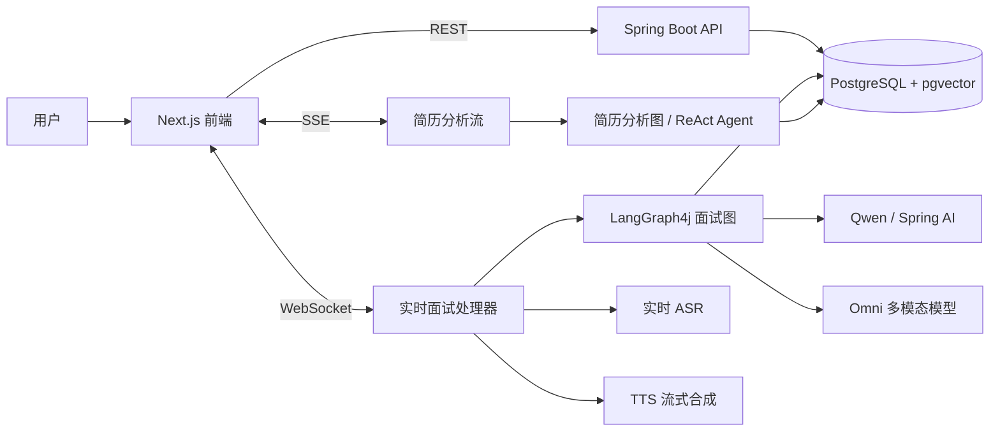
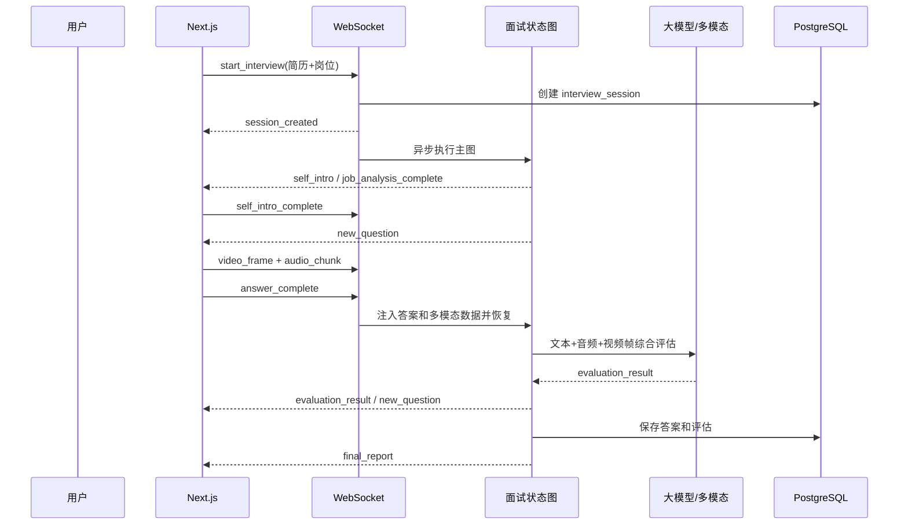
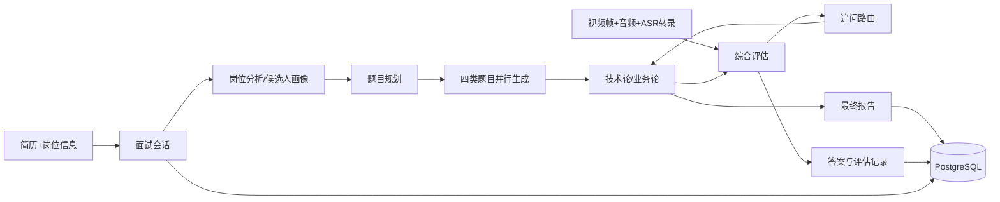
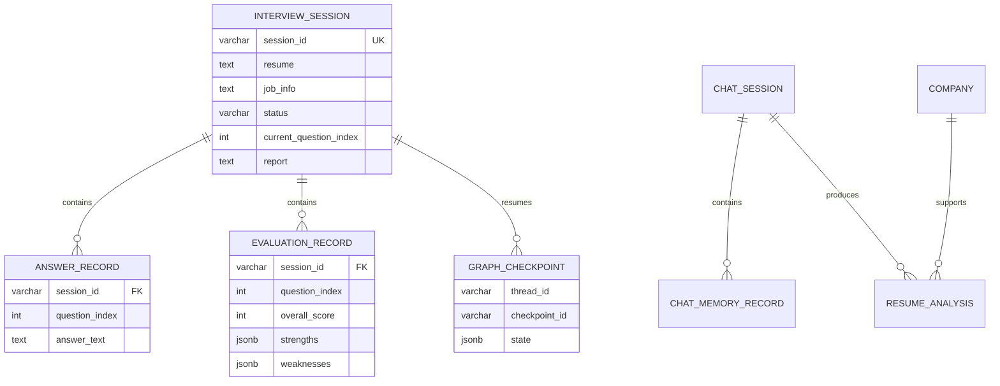

# AI 面试官与简历分析系统：业务流程与数据流程说明

> 本文档基于当前仓库中的 Java 后端、Next.js 前端、数据库脚本和已有协议文档整理。
> 文档只描述当前代码已经形成的能力，不把规划项当作现有功能。

## 1. 项目定位与总体架构

本项目是一个面向求职者的 AI 面试练习与简历分析系统。用户可以上传简历并获取多维度分析，也可以输入岗位信息发起实时视频面试。系统通过大模型、语音识别、语音合成、视频帧分析和状态图编排，完成提问、回答采集、评估、追问和报告生成。

| 层次 | 主要模块 | 主要职责 |
| --- | --- | --- |
| 用户端 | Next.js 16 + React | 简历上传、岗位输入、视频采集、音频采集、问题展示、报告展示 |
| 接口层 | Spring MVC、WebSocket、SSE | REST 查询、实时面试双向通信、简历分析流式进度 |
| 业务层 | InterviewBusinessService、ChatService | 面试会话、图执行、答案提交、简历聊天和分析 |
| AI 编排层 | LangGraph4j 主图与子图、Spring AI Agent | 岗位分析、候选人画像、出题、追问、评估、报告 |
| 模型与扩展能力 | Qwen、DashScope ASR/TTS、Omni 多模态模型 | 文本生成、语音识别、语音合成、多模态评估 |
| 持久化层 | PostgreSQL + pgvector、MyBatis-Plus | 会话、答案、评估、报告、聊天记录、图检查点和向量 |

## 2. 用户端页面与业务入口

| 页面 | 主要业务 | 关键数据 |
| --- | --- | --- |
| `/` | 输入简历、岗位信息和面试配置，开始面试 | 简历文本、岗位信息、题目数量、岗位级别 |
| `/interview/session` | 视频面试、音频采集、问题和评估展示 | `sessionId`、当前问题、回答阶段、评估结果 |
| `/report/[sessionId]` | 查看 Markdown 面试报告 | 报告文本、评估汇总 |
| `/history` | 分页查询面试历史 | 会话状态、岗位信息、创建/结束时间 |
| `/resume` | 上传 PDF/DOCX 简历并查看实时分析进度 | 上传文件、分析阶段、维度评分、雷达图 |
| `/resume/[sessionId]` | 查看简历分析报告并继续对话 | 分析报告、雷达图、聊天会话 |
| `/resume/history` | 查看历史简历分析会话 | 简历文件名、分析状态、创建时间 |

## 3. 核心业务流程

### 3.1 实时面试主流程

1. 用户在首页填写简历和岗位信息，选择技术题、业务题、追问数量及岗位级别。
2. 前端创建 WebSocket 连接到 `/ws/interview`。
3. 前端发送 `start_interview`，后端校验简历和岗位信息并创建 `interview_session`。
4. 后端立即推送 `session_created`，随后使用虚拟线程异步执行 LangGraph4j 面试主图。
5. 主图初始化后并行执行岗位分析和自我介绍阶段；前端收到 `self_intro` 与 `job_analysis_complete` 后进入可答题状态。
6. 用户完成自我介绍后发送 `self_intro_complete`，图继续执行人物画像分析和批量题目生成。
7. 技术轮和业务轮从题目队列取题，通过 `new_question` 推送给前端；TTS 可同时以文本控制消息和二进制 Opus 帧发送问题语音。
8. 前端持续发送视频帧、音频片段和 ASR 转录；用户提交答案时发送 `answer_complete`。
9. 后端恢复图执行，使用文本、原始音频、ASR 时间戳和视频帧进行综合评估，推送 `evaluation_result`。
10. 路由器根据结果决定普通追问、低分深入追问、高分挑战或进入下一题。
11. 两轮结束后生成报告，持久化会话、答案、评估记录并推送 `final_report`。

### 3.2 简历分析流程

1. 前端创建聊天会话 `POST /api/chat/sessions`。
2. 用户选择 PDF 或 DOCX，前端限制文件类型和 10MB 大小。
3. 前端上传文件到 `/api/chat/sessions/{sessionId}/upload`，响应为 SSE。
4. 后端解析简历，执行上传守卫、文本解析、公司调研、技能/项目/背景/潜力维度分析和报告生成。
5. SSE 持续推送 `progress`、`dimension_score`、`radar_chart`、`message`、`done` 或 `error` 事件。
6. 前端将进度和维度结果写入 Zustand，流结束后进入报告页。
7. 用户可以通过 `/api/chat/sessions/{sessionId}/message` 继续进行流式简历问答。

### 3.3 断线恢复

面试图以 `sessionId` 作为 LangGraph4j 的 `threadId`，图状态保存到 `graph_checkpoint`。前端重新连接后发送 `resume_interview`，后端读取检查点并推送 `interview_resumed`，然后继续从中断节点执行。WebSocket 关闭时会停止 ASR、取消 TTS 任务并更新会话连接状态。

## 4. 数据流程

### 4.1 面试数据流

### 4.2 主要数据对象

| 数据对象 | 产生位置 | 主要字段 | 去向 |
| --- | --- | --- | --- |
| `InterviewSession` | WebSocket 启动 | 会话 ID、简历、岗位、题量、状态 | 面试历史、图线程 |
| `InterviewState` | LangGraph4j | 当前轮次、题目队列、回答、画像、评估 | 图节点和 checkpoint |
| `GeneratedQuestion` | 批量题目子图 | 题干、类型、难度、追问标记 | 技术轮和业务轮 |
| `AnswerRecord` | 答案提交 | 问题索引、答案文本、时间 | 数据库和评估 |
| `EvaluationRecord` | 综合评估节点 | 准确性、逻辑、流畅、自信、情绪、肢体、语音、总分 | 前端实时面板和报告 |
| `ResumeAnalysis` | 简历分析图 | 文件名、状态、报告 Markdown、雷达图 | 简历报告页 |
| `ChatSession` / `ChatMemoryRecord` | 简历聊天 | 会话、消息、文件信息 | SSE 对话和历史 |
| `GraphCheckpoint` | 图执行 | thread、节点、下一节点、序列化状态 | 断线恢复 |
| 向量记录 | Spring AI VectorStore | 文本、metadata、1024 维 embedding | 简历/知识检索 |

### 4.3 关系型数据模型

## 5. 接口与状态边界

| 接口/通道 | 作用 | 数据边界 |
| --- | --- | --- |
| `WS /ws/interview` | 面试启动、问题、音频、视频、回答和报告 | 面试会话与图状态 |
| `GET /api/interview/history` | 分页查询面试历史 | `interview_session` |
| `GET /api/interview/report/{sessionId}` | 查询已完成报告 | 会话报告和评估结果 |
| `POST /api/chat/sessions` | 创建简历聊天会话 | `chat_session` |
| `POST /api/chat/sessions/{id}/message` | 简历流式对话 | SSE 消息流和聊天记忆 |
| `POST /api/chat/sessions/{id}/upload` | 上传简历并流式分析 | 文件、分析记录和 SSE 事件 |
| `GET /api/chat/sessions/{id}/analysis` | 获取分析结果 | `resume_analysis` |
| `GET /api/chat/sessions` | 分页查询简历会话 | `chat_session` |

主要状态包括 `WAITING`、`IN_PROGRESS`、`WAITING_ANSWER`、`DISCONNECTED`、`FINISHED`；简历分析记录使用 `PENDING`、`PROCESSING`、`COMPLETED`、`FAILED` 等状态。

## 6. 异常、降级与一致性规则

1. 简历或岗位为空时，WebSocket 启动请求直接返回 `error`。
2. TTS 失败时发送 `audio_question_error`，前端仍可使用文字问题继续面试。
3. 多模态能力关闭或调用失败时，系统按配置降级到纯文本评估。
4. WebSocket 关闭时释放 ASR、TTS 和会话映射，图状态通过 checkpoint 保留。
5. SSE 分析过程中发生异常时发送 `error` 事件并结束流，前端保留已收到的阶段结果。
6. 所有数据库写入通过统一响应、业务异常和全局异常处理暴露错误，不使用成功形状掩盖失败。

## 7. 当前实现与后续边界

当前已经形成闭环的能力包括：实时 WebSocket 面试、视频帧和音频采集、ASR/TTS、LangGraph4j 面试图、动态追问、多模态评估、面试报告、简历上传分析、SSE 进度和历史查询。

当前仍需关注的工程边界包括：模型和外部服务依赖较重、媒体数据带宽与存储成本较高、部分实时映射依赖进程内内存、生产环境需要完善鉴权、限流、对象存储和监控。

如果去完善这个项目，鉴权要怎么做？限流要怎么做？监控要监控什么、怎么做？对象存储是做什么的、怎么做？

工程上的稳定、数据治理上的安全、AI 能力的边界、使用 AI 的安全管控、对整个项目的监控，这些都该怎么做？

