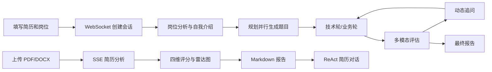

# AI 面试官与简历分析系统：项目功能实现说明

> 本文档按当前 Java/Spring Boot 后端和 Next.js 前端代码说明功能落点。

## 1. 项目现状与整体链路

项目由两个相互关联的产品闭环组成：



## 2. AI 面试功能

### 2.1 面试创建与实时通信

入口是 `InterviewWebSocketHandler`。客户端首先发送 `start_interview`，字段包括简历、岗位信息、技术题数量、业务题数量、追问上限和岗位级别。服务端创建会话后立即返回 `session_created`，避免用户等待完整图执行。

前端 `WebSocketClient` 负责：

- 连接 `/ws/interview`；
- 文本消息 JSON 序列化和校验；
- 二进制音频帧接收；
- 连接断开后的有限次重连；
- 面试消息事件订阅。

### 2.2 面试 Agent 主图

`InterviewAgentGraph` 使用 LangGraph4j 构建主图：

```text
START
  -> init
  -> jobAnalysis || selfIntro
  -> profileAnalysis
  -> batchQuestionGenerator
  -> technicalRound
  -> roundTransition
  -> businessRound
  -> generateReport
  -> END
```

岗位分析和自我介绍从 `init` 分支并行执行；`profileAnalysis` 等待两者完成。自我介绍和技术/业务轮通过 interrupt 让前端参与，用户提交答案后再恢复图执行。

### 2.3 批量题目生成

批量题目子图先由 `QuestionPlanningNode` 分配话题和难度，再并行执行：

- `TechBasicGenNode`：技术基础题；
- `ProjectGenNode`：项目经验题；
- `BusinessGenNode`：业务理解题；
- `SoftSkillGenNode`：软技能题。

`AggregateResultsNode` 合并并重新编号，题目进入状态队列。这样可以将多数题目的模型调用并行化，轮次执行时只需从队列取题。

### 2.4 多模态回答采集与评估

前端通过 WebSocket 发送：

| 消息 | 内容 |
| --- | --- |
| `video_frame` | Base64 视频帧和毫秒时间戳 |
| `audio_start` | 当前回答开始时间 |
| `audio_chunk` | Base64 音频片段 |
| `answer_complete` | 回答结束信号 |
| `self_intro_complete` | 自我介绍结束信号 |

后端在 `submitAnswer` 中将答案文本、视频帧、带时间戳帧、音频和 ASR 转录注入 `InterviewState`，再恢复图执行。Omni 模型按语义、语音副语言和视觉信号综合输出：

- 准确性；
- 逻辑性；
- 流畅度；
- 自信度；
- 情绪；
- 肢体语言；
- 语音语调；
- 综合得分；
- 优点、弱点和追问建议。

### 2.5 动态追问

轮次子图由 `AskQuestionNode`、`ComprehensiveEvaluationNode`、`PersistenceNode` 和 `FollowUpDecisionNode` 组成。路由器根据当前回答和累计追问次数选择：

- 普通追问；
- 低分深入追问；
- 高分挑战追问；
- 进入下一题。

追问问题实时生成，不预先全部放入题目队列。

### 2.6 语音能力

- `AsrRealtimeService` 接收实时 PCM，使用 Fun-ASR Realtime 识别并缓存带时间戳转录。
- `TtsRealtimeService` 将问题合成为流式语音。
- `AudioStreamService` 负责音频会话管理。
- 前端 `AudioEncoderManager`、`AudioStreamManager` 和 `oggMuxer` 完成采集、编码、解码和播放。
- TTS 通过 `audio_question_start`、二进制 Opus 帧、`audio_question_end` 通知播放边界。

## 3. 简历分析功能

### 3.1 上传与 SSE

`ReActChatController` 提供会话创建、上传简历、发送消息、查询分析结果和分页查询会话。上传和消息接口返回 `SseEmitter`，由 `SseHelper` 统一发送：

| SSE 事件 | 用途 |
| --- | --- |
| `progress` | 节点开始/完成状态 |
| `dimension_score` | 技能、项目、背景、潜力等维度得分 |
| `radar_chart` | 雷达图 JSON |
| `thinking_start/end` | Agent 思考阶段 |
| `tool_status` | 工具调用状态 |
| `message` | 流式文本内容 |
| `done` / `error` | 结束或错误 |

前端 `AnalysisProgress` 和 `resumeAnalysisStore` 按事件更新进度节点、维度卡片和雷达图。

### 3.2 简历分析图

简历分析主链路包括：

```text
UploadGuardNode
  -> ParseResumeNode
  -> CompanyResearchNode
  -> BgDimensionNode / SkillDimensionNode / ExpDimensionNode / PotentialDimensionNode
  -> PersistAnalysisNode
  -> ReportGenNode
```

维度分析可以并行执行；公司研究通过 `WebSearchService` 访问外部搜索服务，并使用 `company` 表缓存结果。最终报告以 Markdown 保存，雷达图数据单独保存为 JSON 文本。

### 3.3 ReAct 简历对话

简历分析完成后，用户可以发送消息进行自由追问。`ChatService` 负责保存消息、调用 Spring AI Agent、转发工具状态和流式文本。工具包括简历文件解析和联网搜索，适合解释报告、追问项目细节和补充岗位建议。

## 4. 历史、报告与断线恢复

`InterviewController` 提供面试历史和报告查询；`InterviewBusinessService` 使用 MyBatis-Plus 分页，并支持按岗位信息搜索。面试图 checkpoint 以 `thread_id=sessionId` 保存到 PostgreSQL，WebSocket 断线后通过 `resume_interview` 恢复。

简历分析历史通过聊天会话和分析记录查询。报告页对 Markdown 做目录化展示，面试报告和简历报告的展示逻辑相互独立。

## 5. 持久化与向量检索

PostgreSQL 负责：

- `interview_session`：面试会话和最终报告；
- `answer_record`：回答文本；
- `evaluation_record`：逐题多维评估；
- `chat_session`、聊天记忆表：简历对话；
- `resume_analysis`：简历分析结果；
- `company`：公司调研缓存；
- `graph_checkpoint`：图状态恢复。

Spring AI 自动管理 `vector_store`，使用 `text-embedding-v3` 生成 1024 维向量。向量 metadata 用于按业务对象和来源过滤。

## 6. 已实现能力与边界

已实现：实时视频面试、实时 ASR/TTS、动态追问、多模态评估、LangGraph4j checkpoint、简历四维分析、SSE 流式交互、历史和报告。

边界：项目依赖 DashScope、模型 API 和 PostgreSQL；当前 WebSocket 会话映射与部分任务控制依赖应用进程内对象；部署到多实例前需要引入共享会话、消息路由和分布式任务机制。

