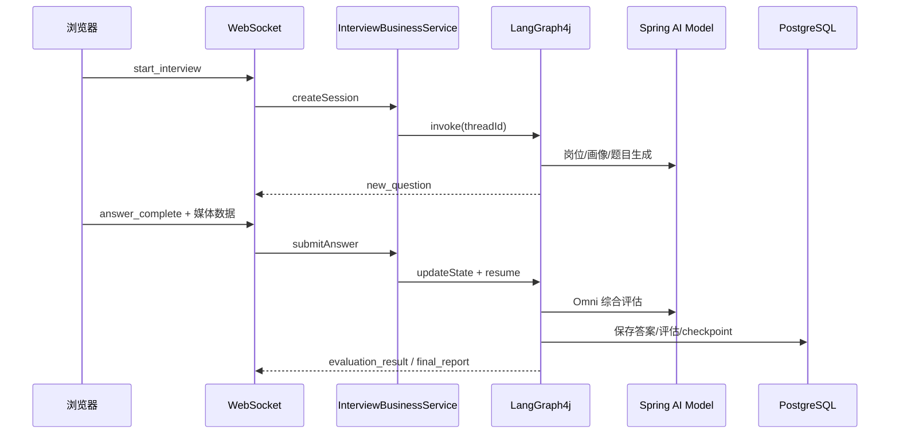

# AI 面试官与简历分析系统：项目框架使用说明

本文档只说明框架在当前代码中的实际落点，重点回答 Spring Boot、Spring AI、LangGraph4j、WebSocket 和 SSE 如何协作。

## 1. 框架分工

| 框架/组件 | 当前职责 | 主要位置 |
| --- | --- | --- |
| Spring Boot 3.4 | 应用启动、依赖注入、MVC、异常处理、配置和生命周期 | `backend/src/main/java/com/zunff/interview` |
| Spring AI 1.0 | Chat Model、Prompt、ReAct Agent、Embedding、VectorStore | `config/`、`service/`、`agent/` |
| LangGraph4j 1.8 | 有状态面试主图、轮次子图、checkpoint、interrupt/resume | `agent/graph/`、`agent/nodes/` |
| Spring WebSocket | 实时问题、视频帧、音频、答案和报告 | `websocket/InterviewWebSocketHandler.java` |
| Spring SSE | 简历分析进度和 ReAct 对话流 | `common/sse/`、`ReActChatController.java` |
| MyBatis-Plus | PostgreSQL 业务表的实体、Mapper、分页查询 | `model/entity/`、`mapper/` |
| Next.js 16 | App Router 页面、浏览器媒体能力和报告 UI | `frontend/app/`、`components/` |
| Zustand | 前端面试和简历分析状态 | `frontend/store/` |

## 2. Spring Boot 的使用方式

### 2.1 应用创建与配置

`AgentApplication` 是启动入口。配置通过 `application.yml`、`application-dev.yml` 和 `@ConfigurationProperties` 注入，覆盖：

- PostgreSQL 数据源；
- Spring AI OpenAI 兼容模型；
- pgvector；
- 面试图递归上限；
- Omni、ASR、TTS 和知识库开关；
- 虚拟线程执行器。

示例配置使用 DashScope OpenAI 兼容地址，实际密钥通过环境变量提供。

### 2.2 Controller 与统一响应

REST 控制器使用 `@RestController`、`@RequestMapping`、`@GetMapping` 等注解：

- `AgentController`：健康检查和系统信息；
- `InterviewController`：历史和报告；
- `ReActChatController`：简历聊天和上传。

普通接口返回 `ApiResponse<T>`，分页接口返回 `PageResult<T>`。异常由 `GlobalExceptionHandler` 统一转换；SSE 接口使用 `SseEmitter`，不强行套用普通 JSON 响应。

### 2.3 WebSocket 配置与处理

`WebSocketConfig` 注册 `/ws/interview`，`InterviewWebSocketHandler` 以消息 `type` 分发行为。文本消息使用 `WebSocketMessage<T>` 包装，包含 `type`、`payload` 和时间戳；音频则以二进制帧发送。

处理器维护三类映射：

```text
interviewSessionId -> WebSocketSession
webSocketSessionId -> interviewSessionId
interviewSessionId -> TTS Future
```

连接关闭时取消 TTS、停止 ASR 和断开会话。生产多实例部署时这些映射需要迁移到共享会话或由网关保持粘性。

### 2.4 SSE 的使用

`SseHelper` 封装进度、维度得分、雷达图、工具状态、消息、完成和错误事件。服务层负责异步执行，控制器只负责创建 `SseEmitter` 和转交业务调用。前端 `sseParser` 将事件转换为强类型事件，再更新 Zustand。

## 3. Spring AI 的使用方式

### 3.1 Chat Model 与 Prompt

项目使用 Spring AI 的 OpenAI 兼容适配器连接 Qwen 等模型。Prompt 模板由 `PromptTemplateService` 和资源目录中的提示词管理，业务节点负责准备候选人画像、岗位信息、问题、回答等变量。

典型调用路径为：

```text
节点准备状态数据
  -> PromptTemplateService 读取模板
  -> ChatClient/模型调用
  -> JSON 或 Markdown 解析
  -> BO/DTO 校验
  -> 写回 InterviewState 或 ResumeState
```

### 3.2 ReAct Agent 与工具

简历对话使用 Spring AI Agent 机制，根据对话内容决定是否调用工具。工具包括文件解析和联网搜索；`FinishChatTool` 用于结束或收束对话。工具状态通过 SSE 发送给前端，避免用户误以为请求没有响应。

### 3.3 Embedding 与 pgvector

Spring AI Embedding 模型将文本转换为 1024 维向量，向量写入 PostgreSQL 的 `vector_store`。知识检索使用相似度查询和 metadata 过滤，数据库脚本中明确启用 `vector` 扩展。

## 4. LangGraph4j 的实际位置

### 4.1 主图

`InterviewAgentGraph` 显式使用 `StateGraph`、`START`、`END`、`CompiledGraph` 和 `CompileConfig`。主图边关系如下：

```text
START -> init
init -> jobAnalysis
init -> selfIntro
jobAnalysis + selfIntro -> profileAnalysis
profileAnalysis -> batchQuestionGenerator
batchQuestionGenerator -> technicalRound
technicalRound -> roundTransition
roundTransition -> businessRound
businessRound -> generateReport
generateReport -> END
```

编译时配置主递归上限、checkpoint saver，以及自我介绍和轮次提问节点的中断位置。

### 4.2 子图

- `BatchQuestionSubgraph`：规划题目后并行生成技术基础、项目、业务和软技能题。
- `InterviewRoundSubGraph`：复用技术轮和业务轮逻辑，完成提问、评估、持久化和追问路由。
- `ResumeAnalysisGraph`：编排简历解析、公司研究、维度评分、持久化和报告。

### 4.3 状态、checkpoint 与恢复

`InterviewState` 是面试图的共享状态，`ResumeState` 是简历分析状态。面试图执行时使用 `RunnableConfig.threadId(sessionId)`，`PostgresCheckpointSaver` 将状态持久化到 `graph_checkpoint`。提交答案通过 `updateState` 注入媒体数据，再调用 `GraphInput.resume()`。

这使图可以在用户参与的中断点暂停，而不是把整个面试流程写成一个长时间阻塞的 HTTP 请求。

## 5. Spring AI、LangGraph4j 与实时层的调用链



简历分析的区别是：请求不使用 WebSocket，而是由 `SseEmitter` 持续发送节点进度、评分和报告文本。

## 6. 前端框架的使用方式

### 6.1 Next.js App Router

`app/` 目录按业务页面组织路由。面试页由 `VideoInterview` 负责摄像头、麦克风和实时交互；报告页使用 Markdown 规范化和目录导航；简历页使用拖拽上传和分析进度组件。

### 6.2 Zustand 状态边界

`interviewStore` 保存会话 ID、当前问题、面试阶段、评估结果、报告、音频播放和媒体开关。`resumeAnalysisStore` 保存分析阶段、节点状态、维度评分、雷达图和错误。WebSocket/SSE 事件是状态更新的唯一入口，页面组件主要负责展示和触发用户动作。

### 6.3 音视频处理

浏览器通过 MediaDevices 获取摄像头和麦克风；MediaPipe Face Landmarker 负责前端视觉检测。音频由 Web Audio API 采集，编码器管理器降采样并编码，播放管理器解码服务端 Opus 二进制帧。前端还保留 Mock WebSocket 客户端，便于无后端开发。

## 7. 如何运行相关代码

1. 在 `backend` 中准备 Java 21、PostgreSQL/pgvector 和模型 API 密钥。
2. 可先执行 `docker compose up -d` 启动 PostgreSQL，再复制 `application-example.yml` 为开发配置。
3. 使用 Maven 启动 Spring Boot 后端。
4. 在 `frontend` 执行 `pnpm install`、`pnpm dev`，默认访问 `http://localhost:3000`。
5. 前端通过 `WS_BASE_URL` 指向后端 WebSocket；REST 请求默认走本地后端配置。
6. 无后端时可以使用 `pnpm mock` 验证前端面试交互。

