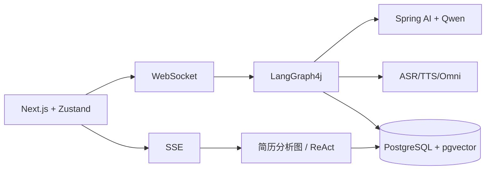

# AI 面试官与简历分析系统：项目面试介绍与高频问答

## 1. 一句话定位

这是一个基于 Spring Boot、LangGraph4j 和 Spring AI 构建的多模态 AI 面试系统，同时提供简历上传分析和流式追问能力；它把岗位分析、针对性出题、语音视频采集、动态追问、综合评估和报告生成串成了一个可恢复的实时闭环。

## 2. 可直接口述的 90 秒版本

我参与的是一个 AI 面试官和简历分析系统。前端使用 Next.js，后端使用 Spring Boot，面试实时交互采用 WebSocket，简历分析和聊天采用 SSE。面试启动后，后端用 LangGraph4j 编排状态图：先并行完成岗位分析和自我介绍，再根据候选人画像和岗位要求规划题目，并行生成技术基础、项目、业务和软技能问题。用户回答时，浏览器会发送回答文本、原始音频、ASR 转录以及带时间戳的视频帧，后端再通过 Omni 多模态模型进行综合评估。评估之后由路由节点决定普通追问、低分深入追问、高分挑战，或者进入下一题。整个图以 sessionId 作为 threadId，并把 checkpoint 保存到 PostgreSQL，因此 WebSocket 断开后可以恢复。

简历模块是另一个闭环：上传 PDF/DOCX 后，通过 SSE 推送解析、公司调研、技能、项目经验、教育背景和发展潜力等维度的进度及评分，最终生成 Markdown 报告和雷达图；分析完成后还可以通过 ReAct Agent 继续对话。这个项目比较有挑战的地方是实时媒体数据和状态图的结合、模型输出的不确定性、断线恢复，以及多模态评估的降级设计。

## 3. 系统架构与业务流

## 4. 最值得展开的技术点

### 4.1 为什么面试使用 WebSocket？

面试不是一次请求一次响应，而是需要服务端推送新问题、评估结果、TTS 控制事件和最终报告，同时客户端持续上传音频和视频帧。WebSocket 可以提供双向、低延迟、长连接通道；简历分析则更适合用 SSE，因为它主要是服务端单向推送进度和文本。

### 4.2 为什么使用 LangGraph4j，而不是普通 Service 串联？

面试包含并行节点、人工参与的中断点、条件追问、循环轮次和最终汇总。状态图能显式表达节点、边和共享状态，并用 checkpoint 保存恢复位置。普通 Service 串联很难清晰表达“等待用户回答后继续”和断线恢复。

### 4.3 如何实现题目并行生成？

批量题目子图先由规划节点分配四类题目的数量、主题和难度，再让四个生成节点并行调用模型，最后由聚合节点统一合并和编号。这样减少了串行等待，也能通过规划阶段降低题目重复。

### 4.4 如何做动态追问？

评估节点先生成多维得分和追问建议，`FollowUpDecisionNode` 再结合得分、当前轮次和已追问次数进行路由。低分进入深入追问，高分进入挑战追问，普通情况生成常规追问；达到上限后转入下一题，避免无限循环。

### 4.5 多模态评估如何处理 ASR 错误？

原始音频是语义和副语言判断的主要依据，ASR 文本作为辅助参考；视频帧用于表情和肢体语言。回答数据会带时间戳，模型可以对齐音频转录和关键帧。这样可以降低同音词或识别错误对内容评分的影响。

### 4.6 断线恢复怎么实现？

每个面试 sessionId 对应 LangGraph4j 的 threadId。图在中断点由 `PostgresCheckpointSaver` 保存状态；前端重连后发送 `resume_interview`，服务端恢复图状态并返回当前轮次和中断节点。需要注意，WebSocket 到会话的内存映射仍属于实例级资源，多实例部署还需要共享路由或粘性会话。

### 4.7 如何处理模型输出不稳定？

节点通过 Prompt 约束输出格式，使用 DTO/BO 和 JSON 解析做边界校验；解析失败由业务异常和错误消息暴露，不把非法结果伪装成成功。报告和题目生成需要结合日志、超时和降级策略，不能只判断 HTTP 调用是否成功。

### 4.8 为什么简历分析使用 SSE？

简历分析包含多个耗时节点，用户需要看到解析、公司调研和各维度评分的实时反馈。SSE 允许后端保持一个 HTTP 响应并持续发送命名事件，浏览器端实现简单，也适合文本流式输出；它不适合客户端持续上传视频，所以与面试 WebSocket 分开。

### 4.9 PostgreSQL、pgvector 和 checkpoint 分别做什么？

PostgreSQL 保存会话、答案、逐题评估、报告、聊天和简历分析结果；pgvector 通过 Spring AI VectorStore 保存 embedding，支持语义检索；`graph_checkpoint` 保存 LangGraph4j 的线程状态和下一个节点，用于中断和恢复。

### 4.10 如何控制实时资源和并发？

模型、ASR、TTS 和图执行使用虚拟线程执行器；媒体数据采用流式方式传输，并在会话关闭时停止 ASR、取消 TTS Future。实际生产还需要增加连接数限制、音频大小限制、超时、限流和背压策略。

### 4.11 前端为什么需要 Mock WebSocket？

面试页面依赖多个服务端事件，单独开发 UI 时如果没有后端很难验证状态切换。Mock 客户端复用真实客户端的事件接口，模拟连接、问题、评估和报告消息，从而支持 `pnpm mock` 离线验证；它不代表生产链路。

### 4.12 当前项目最大的技术债是什么？

第一是实时会话映射和部分任务控制依赖单实例内存；第二是模型、ASR、TTS 和多模态服务的外部依赖较多；第三是媒体数据成本和隐私治理需要进一步完善。上线前应优先补充鉴权、限流、分布式会话、对象存储、可观测性和敏感数据保护。

## 5. 高频问题与参考回答

### Q1：你在项目中具体负责什么？

可以按真实经历回答：我主要负责【面试图/实时通信/简历分析/前端交互中的实际模块】。具体工作包括梳理状态边界、实现节点或接口、处理模型输出校验、接入 WebSocket/SSE、补充断线和错误处理，并通过日志和集成测试验证端到端链路。不要把未实际完成的模块描述为独立负责。

### Q2：为什么技术题和业务题要分轮？

技术轮重点验证基础知识、项目实现和技术深度；业务轮重点验证业务理解、方案权衡和沟通能力。分轮后可以复用同一轮次子图，只替换题目来源和轮次配置，也便于分别控制题量和追问上限。

### Q3：为什么岗位分析和自我介绍并行？

两者都依赖初始简历/岗位输入但相互独立，并行可以减少首轮等待；人物画像分析必须等待两者完成，因此主图使用 fan-out/fan-in 结构，在 `profileAnalysis` 处汇合。

### Q4：如果 Omni 多模态模型不可用怎么办？

根据 `multimodal.enabled` 和调用结果降级到纯文本评估，仍然保留问题、回答和报告主流程，并向日志和前端暴露降级状态。降级必须是显式的，不能默默把不完整结果当成完整多模态评估。

### Q5：如何防止追问无限循环？

状态中记录当前轮次和追问次数，路由节点在决策时同时检查 `maxFollowUps`；达到上限直接结束追问并进入下一题或下一轮。

### Q6：为什么不让前端直接计算最终成绩？

前端可以展示实时结果，但最终评估需要统一模型、原始媒体和服务端状态，必须由后端生成并持久化。前端只负责渲染，不应成为报告权威来源。

### Q7：SSE 断开后能否继续简历分析？

当前 SSE 流断开后前端可以重新查询分析结果；是否从中间节点自动继续取决于简历分析图和持久化状态。面试主流程明确使用 checkpoint 做断线恢复，简历分析应在生产中进一步补充任务级恢复与幂等策略。

### Q8：如何验证题目质量？

不能只验证接口返回 200。应检查题目数量、题型和难度字段、题干非空、选项与答案一致、题目不重复，并结合人工抽样和离线评估集检查岗位相关性、难度分布和追问有效性。

### Q9：如果要上线，优先改什么？

优先做鉴权和权限边界、敏感简历和媒体数据保护、WebSocket 多实例路由、任务和消息可恢复、模型调用限流与超时、指标和链路追踪，以及 PostgreSQL/向量库备份。之后再优化模型成本和视觉分析精度。

## 6. 面试时不要这样说

- 不要说项目完全是“普通 CRUD”，核心难点在实时媒体、模型编排和可恢复状态。
- 不要说 LangGraph4j 只是一个 Prompt 模板，它实际管理有状态节点、边、中断和 checkpoint。
- 不要说 ASR 文本就是唯一评估依据，当前设计明确把原始音频作为重要参考。
- 不要把前端 Mock 模式说成生产后端。
- 不要把规划中的分布式任务、完整权限系统或对象存储说成已经实现。

## 7. 需要提前准备的真实信息

1. 自己实际负责的类、节点或页面，以及对应的提交范围。
2. 使用过的模型、提示词、超时和降级配置。
3. 一次 WebSocket 面试从连接到报告的真实日志。
4. 一次简历 SSE 上传的事件顺序和异常处理。
5. PostgreSQL、pgvector 和 checkpoint 在本地如何启动、验证和清理。
